# ProcureFlow: Smart Enterprise Procurement System

> This repository documents the project (description, architecture, workflow, screenshots). The source code lives in a private repository, `Smart-Enterprise-Procurement-System-code`.

**Project site:** [https://kart4206.github.io/Smart-Enterprise-Procurement-System/](https://kart4206.github.io/Smart-Enterprise-Procurement-System/)

An enterprise Source-to-Pay (S2P) platform that takes a purchase from the first internal request to final payment: requisition, rule-based approval, RFQ and quotations, purchase order, vendor delivery, goods receipt, three-way invoice matching, payment and closure. Each of the nine roles works from its own queue, and every step is recorded in an audit trail.

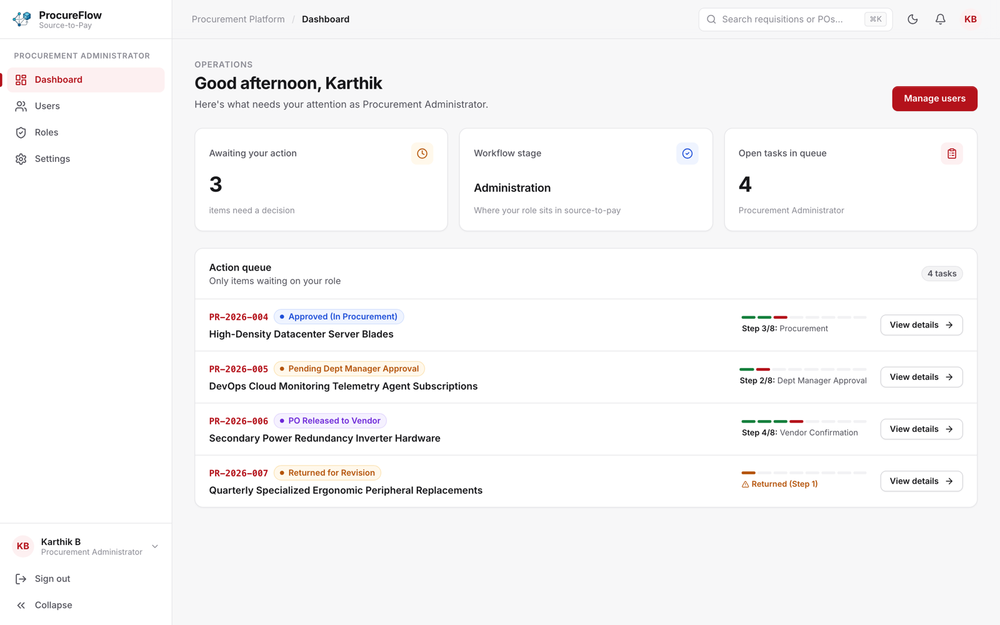

## What it does

- Requesters raise purchase requisitions with line items, cost-centre allocations and a live preview of the approval chain the request will follow.
- Approval routing comes from database rules (department, category and amount), not a fixed sequence.
- Department managers approve, reject or return requests with remarks. Final approval generates the purchase order.
- Procurement managers run RFQ bidding rounds and compare vendor quotations. Vendors confirm and dispatch POs from their own portal.
- The warehouse logs goods receipts (GRN) and verifies deliveries, including partial receipts.
- Accounts payable runs three-way matching (PO, GRN, invoice). Finance releases payments and tracks budget.
- Every role lands on a dashboard listing only the items waiting on it, with an 8-step workflow tracker on each item.
- Reports cover spend by department and category, with CSV export, plus the audit log.

## Workflow

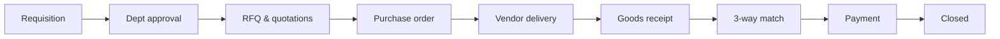

| Step | Owner | Screen |
|---|---|---|
| 1 Requisition | Requester | New requisition, My requests |
| 2 Department approval | Department manager | Pending approvals, Department requests |
| 3 Sourcing and PO | Procurement manager | RFQs, Quotations, Purchase orders |
| 4 Confirmation and delivery | Vendor | My quotations, My purchase orders |
| 5 Goods receipt | Warehouse manager | Goods receipt, Verification, Inventory |
| 6 Invoice matching | AP officer | Invoice matching |
| 7 Payment | Finance manager | Payments, Budget, Reports |
| 8 Closed | System | Audit log |

Support staff handle tickets, and administrators manage users, roles, suppliers, the category catalog and approval rules. An admin can switch role perspective to see any queue.

More detail: [docs/ARCHITECTURE.md](docs/ARCHITECTURE.md).

## Screenshots

| | |
|---|---|
| 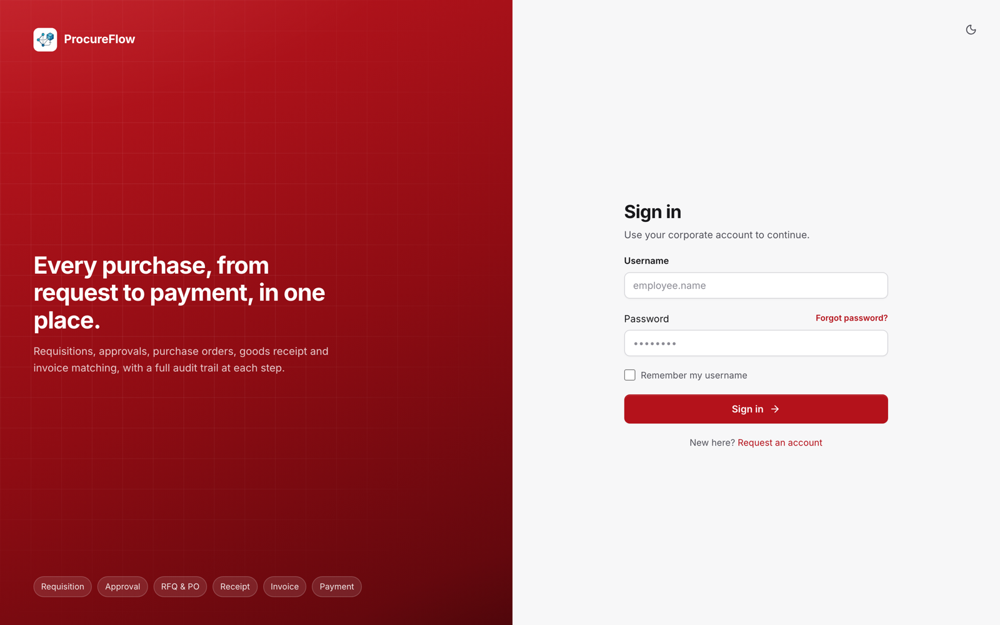 | 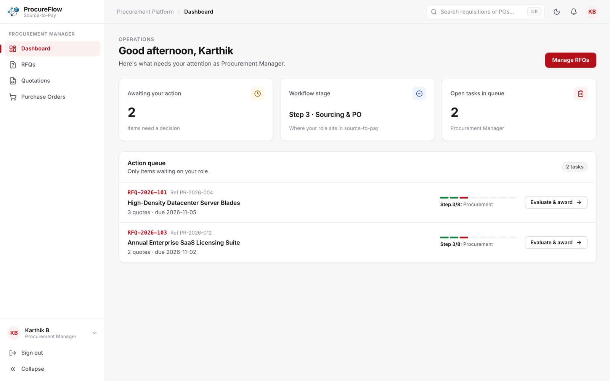 |
| 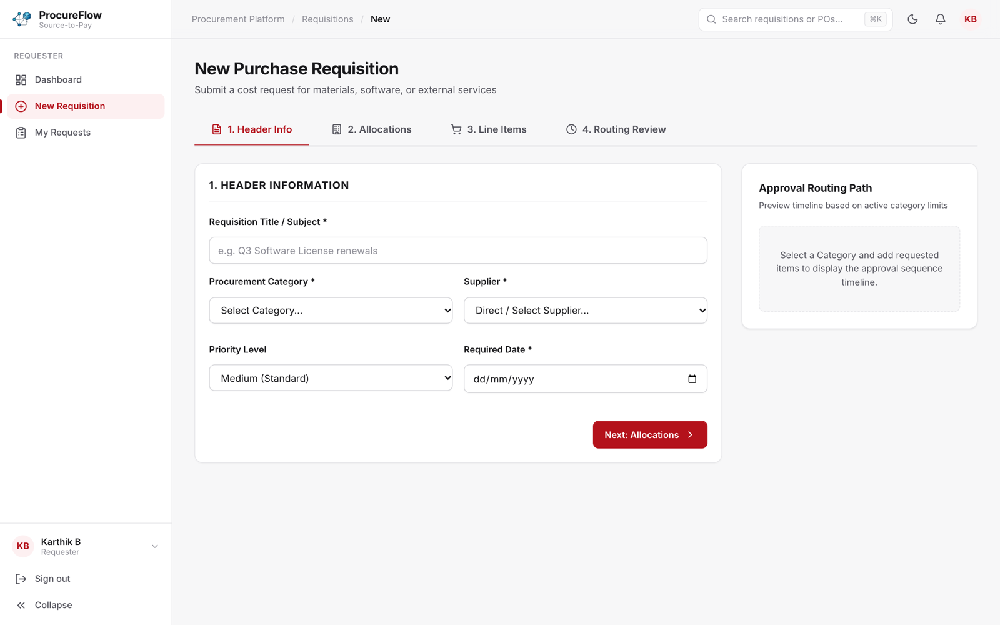 | 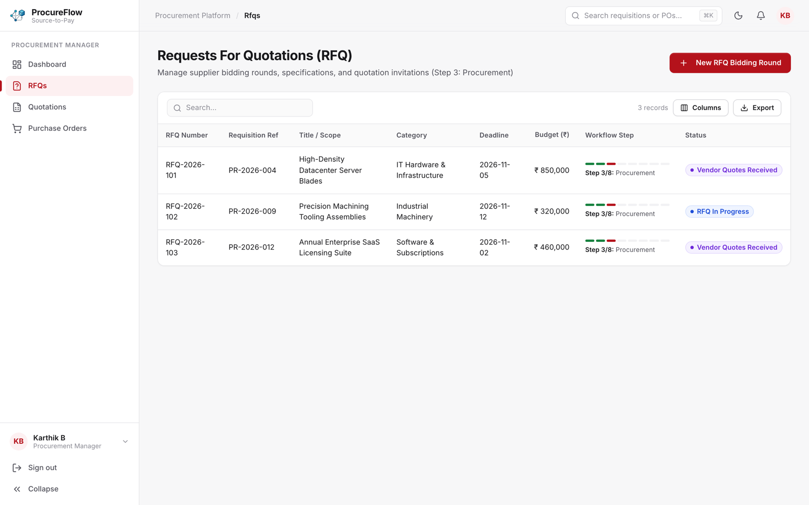 |
| 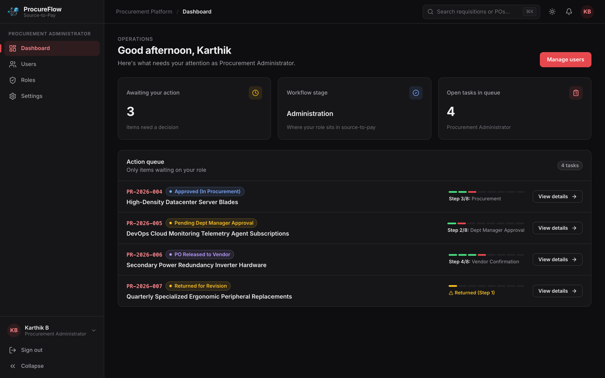 | 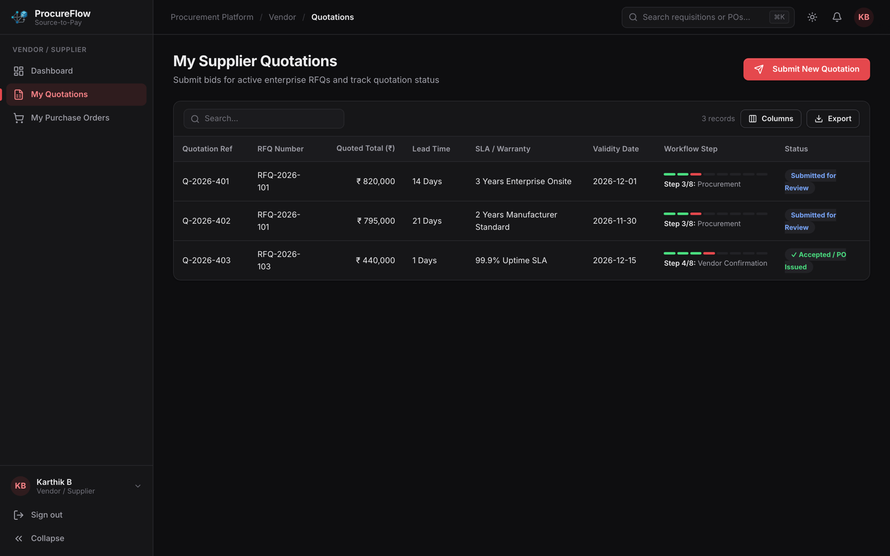 |
| 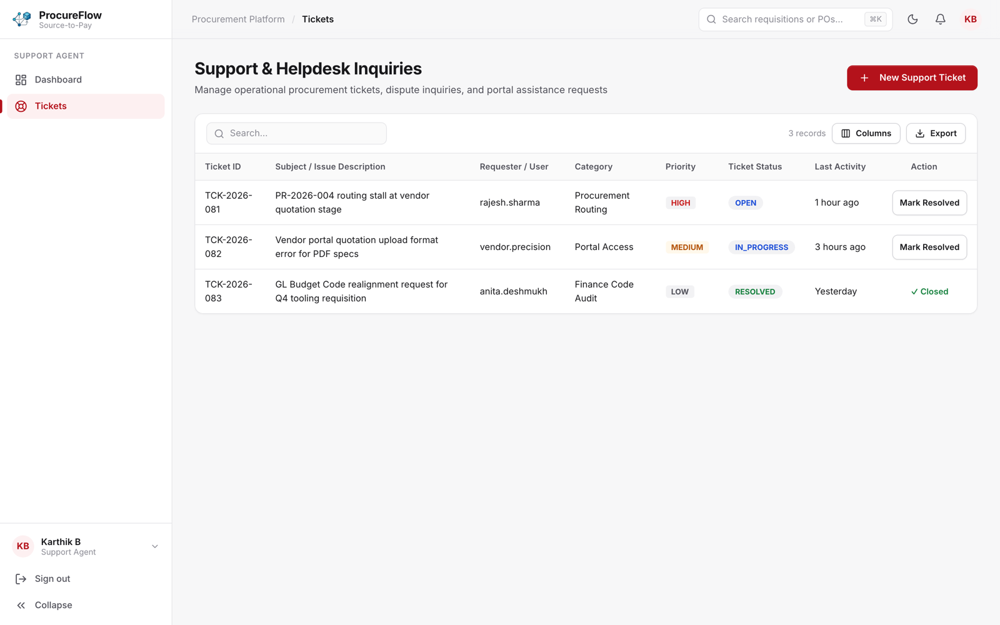 | 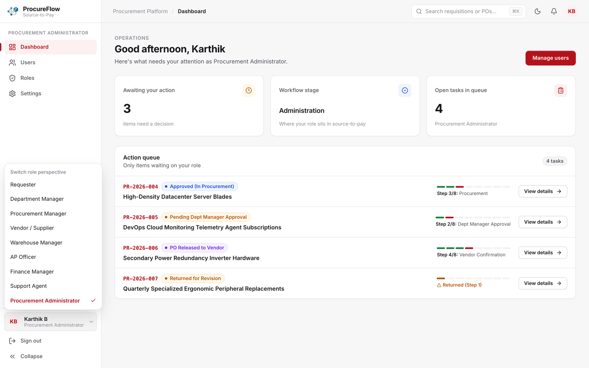 |

Mobile:

<p>
  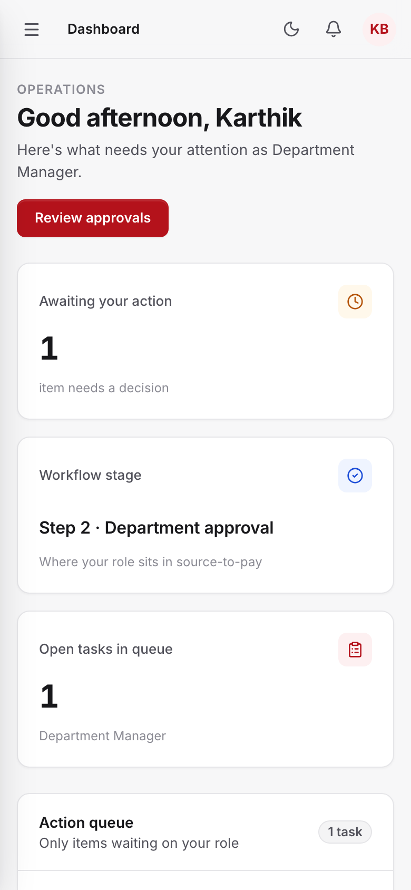
  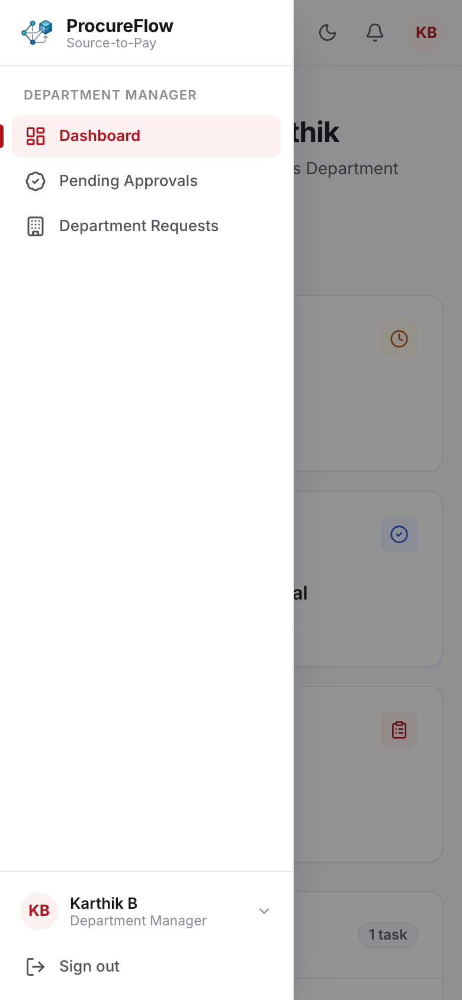
</p>

## Interface

The UI was reworked in November 2026 ([CHANGELOG](docs/CHANGELOG.md)):

- A token-based design system with light and dark themes. The theme follows the OS setting by default, can be toggled, and never flashes on load.
- A collapsible sidebar that becomes a drawer on mobile, plus a sticky top bar with breadcrumbs, ⌘K search, notifications and an account menu.
- Role dashboards with KPI cards, an action queue, loading skeletons and empty states.
- A shared data table with search, sorting, column visibility, CSV export and pagination.
- Works at 375 px phone width without horizontal scrolling.

## Tech stack

| Layer | Technology |
|---|---|
| Frontend | React 19, Vite, React Router 7, Axios, lucide-react, plain CSS with design tokens |
| Backend | Java 21, Spring Boot 3.5 (Web, Data JPA, Security, Validation) |
| Auth | JWT (jjwt), BCrypt, role-based access control |
| Database | PostgreSQL 16, SQL schema and seed scripts |
| API docs | springdoc OpenAPI / Swagger UI |

## Running locally

From the source repository:

```bash
# database
createdb enterprise_procurement
psql enterprise_procurement -f database/schema/enterprise_procurement_schema.sql
psql enterprise_procurement -f database/data/enterprise_procurement_data.sql

# backend (http://localhost:8080, Swagger at /swagger-ui.html)
cd backend
DB_PASSWORD=... JWT_SECRET=... ./mvnw spring-boot:run

# frontend (http://localhost:5173)
cd frontend
npm install
npm run dev
```

Secrets are read from environment variables only. See [docs/SECURITY.md](docs/SECURITY.md).

## Limitations

- RFQ, quotation, vendor, warehouse, invoice-matching and ticket screens partly run on built-in sample data while their backend endpoints are being completed.
- Notifications poll every 30 seconds; there is no push channel.
- No automated end-to-end test suite yet.

## Credits

| Contributor | GitHub |
|---|---|
| Dhivagar | [@Dhivagar003](https://github.com/Dhivagar003) |
| Karthik B | [@KArT4206](https://github.com/KArT4206) |

Released under the MIT License.
