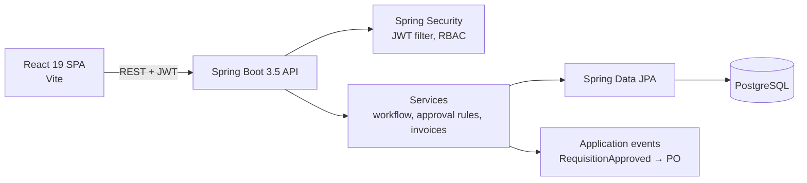

# Architecture

## Overview

## Backend

`com.enterprise.procurement`:

| Package | Contents |
|---|---|
| `controller` | REST endpoints: auth, requisitions, history, line items, approval rules and approvers, purchase orders, PO line items, receipts, invoices, payments, suppliers, categories, departments, cost centres, users, roles, notifications, audit log, dashboard |
| `service` | Business logic: approval rule evaluation, invoice validation against the PO, notifications, audit logging, dashboard summaries |
| `entity` | JPA entities: Requisition, RequisitionLineItem, RequisitionHistory, ApprovalRule, ApprovalRuleApprover, PurchaseOrder, POLineItem, POReceipt, Invoice, Payment, Supplier, Category, Department, CostCenter, User, Role, UserRole, Notification, AuditLog |
| `event` | `RequisitionApprovedEvent` and listener that generates the purchase order |
| `security` | `JwtService`, `JwtAuthenticationFilter`, `SecurityConfig`, `CustomUserDetailsService` |
| `exception` | `GlobalExceptionHandler` with consistent error responses |
| `dto` | Request and response objects |

## Approval routing

Rules are rows in `approval_rules` keyed by department, category and amount band. Each rule lists its approvers in order (`approval_rule_approvers`). On submit, the service picks the matching rule and walks the chain. Each action (approve, reject, return) writes a `requisition_history` row with user, role, remarks and timestamp. The final approval publishes `RequisitionApprovedEvent`, and the listener creates the PO.

## Frontend

| Path | Role |
|---|---|
| `src/App.jsx` | Routes and `ProtectedRoute` guard per role code |
| `src/components/DashboardLayout.jsx` | App shell: sidebar, top bar, role switcher, notifications |
| `src/components/ui/` | Button, Card, PageHeader, StatCard, Badge, Modal, EmptyState, Skeleton, ThemeToggle |
| `src/components/EnterpriseTable.jsx` | Shared table: search, sort, columns, CSV export, pagination |
| `src/components/WorkflowStepper.jsx` | 8-step tracker, compact and full |
| `src/styles/` | Design system primitives and aliases for older class names |
| `src/index.css` | Design tokens for the light and dark themes |
| `src/utils/workflowMapping.js` | Status to step, label and colour mapping |
| `src/utils/roles.js` | Role codes, labels and default routes |
| `src/features/*` | One folder per module: requisitions, purchase-orders, procurement, vendor, warehouse, invoices, finance, analytics, masterdata, support, auth |

### Theming

All colours are CSS custom properties on `:root`, overridden under `[data-theme="dark"]`. An inline script in `index.html` sets the theme before first paint from `localStorage`, falling back to `prefers-color-scheme`.

## Roles

`REQUESTER`, `DEPT_MANAGER`, `PROCUREMENT_MGR`, `VENDOR`, `WAREHOUSE_MGR`, `AP_OFFICER`, `FINANCE_MGR`, `SUPPORT`, `ADMIN`. The sidebar, dashboard queue and route guards all key off the active role. `ADMIN` can open every route.
